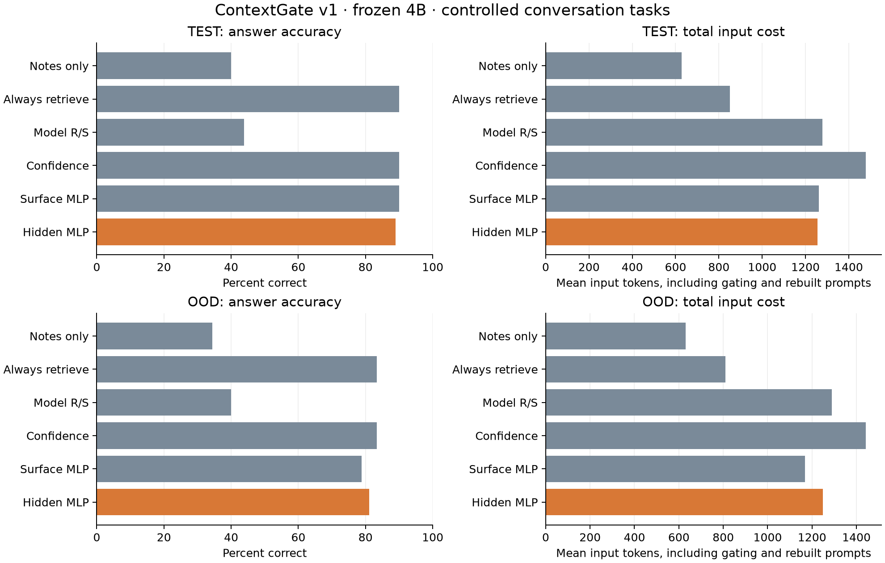

# ContextGate v1 — Modal experiment report

Run: `20260910-v1`. Status: **complete**.

Modal app: `ap-eoBCSOVZ0Sdio1pNLJmIbO`. Function call: `fc-01M23P9WY6PJX1SFM6260M4N8E`.
Measured function elapsed time: 875.3 seconds.
Elapsed function time is distinct from billed usage.

Source SHA-256: `83a2e807a56c6b9fd82f7a4eaf7a80c98e893a3b611bf4572737b0f3d2f46888`.
Dataset SHA-256: `80802e9652e93c6d9c4af77f855a655f3e65111a0d11ab26c4ea35d5cbfb1c6b`.
Verified 254 downloaded artifact hashes and local/remote source binding.

## Result and interpretation

**does_not_advance** under the locked advancement rules. Test accuracy: notes-only 40.00%, ordinary always-retrieve 90.00%, surface MLP 90.00%, primary hidden MLP 88.89%.

The hidden controller uses 47.7% more input tokens than always-retrieve because it evaluates notes before rebuilding the retrieved prompt. Its retrieval decisions do not repay that extra pass in this workload. This result is specific to the tested reader, controlled notes, retrieval policy, and no-cache-reuse execution.

Benefit AUC is 0.9201 for the hidden MLP and 0.9242 for the surface MLP. This pilot supplies no evidence of incremental value from internal states over visible coverage/confidence features. It does not overturn the earlier, separate KV-policy findings.

## Scope

Frozen Qwen3-4B-Instruct-2507; trained three-seed retrieval-utility controllers.
Controlled synthetic notes/history tasks and forced A/B/C/D or R/S choices.
No claim about natural agent performance, learned summaries, repeated resets, or KV certification.

## Data and smoke

```json
{
  "cross_split_archive_overlap": 0,
  "episodes": 600,
  "items": 1800,
  "splits": {
    "calibration": 180,
    "ood": 180,
    "test": 360,
    "train": 900,
    "validation": 180
  }
}
```

Modal-reported app cost: **$1.03092075** (billing queried 2026-09-09T18:34:54.019598+00:00).
Source command: `modal billing report --for today --json`; retained only this app's rows in `billing.json`.

Reader revision: `cdbee75f17c01a7cc42f958dc650907174af0554`. GPU: NVIDIA H100 80GB HBM3.
Backbone parameters: 4,022,468,096; trainable: 0.

Smoke passed: **True**. Notes 36.11%, ordinary retrieval 86.11%, oracle evidence 94.44%; 18 repairs.

## Training

| Controller | Seed | Best epoch | Train loss, initial → selected | Validation loss | Weight change L2 |
|---|---:|---:|---:|---:|---:|
| hidden_linear | 0 | 30 | 1.2329 → 0.3694 | 0.5421 | 1.4247 |
| hidden_linear | 1 | 32 | 1.1922 → 0.3577 | 0.5220 | 1.4579 |
| hidden_linear | 2 | 34 | 1.1311 → 0.3380 | 0.5227 | 1.5129 |
| hidden_mlp | 0 | 1 | 1.1747 → 0.4182 | 0.4397 | 2.1031 |
| hidden_mlp | 1 | 5 | 1.0920 → 0.2867 | 0.4471 | 2.9616 |
| hidden_mlp | 2 | 3 | 1.0955 → 0.3315 | 0.4625 | 2.6413 |
| surface_mlp | 0 | 46 | 1.0126 → 0.4499 | 0.4732 | 2.7748 |
| surface_mlp | 1 | 44 | 1.1599 → 0.4754 | 0.5047 | 2.8742 |
| surface_mlp | 2 | 71 | 1.0950 → 0.4412 | 0.4782 | 3.1252 |

Frozen non-hidden comparator: **surface_mlp** (selected on calibration).

## TEST

| Arm | Accuracy | Retrieval | Mean input tokens | Error without retrieval | Oracle-conditioned loss |
|---|---:|---:|---:|---:|---:|
| always_retrieve | 90.00% | 100.00% | 850.5 | 0.00% | 7.49% |
| confidence | 90.00% | 100.00% | 1478.0 | 0.00% | 7.49% |
| hidden_linear | 90.28% | 99.17% | 1470.6 | 0.00% | 7.20% |
| hidden_mlp | 88.89% | 74.17% | 1255.8 | 2.22% | 8.65% |
| notes_only | 40.00% | 0.00% | 627.6 | 60.00% | 58.50% |
| oracle_action | 91.11% | 51.11% | 1067.4 | 8.89% | 6.34% |
| oracle_evidence | 96.39% | 100.00% | 756.7 | 0.00% | 0.00% |
| self_calibrated | 89.72% | 98.33% | 1479.3 | 0.56% | 7.78% |
| self_raw | 43.89% | 8.89% | 1278.2 | 53.89% | 54.47% |
| surface_mlp | 90.00% | 76.94% | 1261.4 | 0.00% | 7.49% |

Primary hidden MLP minus surface_mlp, episode-cluster 95% CIs:

- Accuracy: -1.11 pp [-2.50, +0.00].
- Utility (accuracy − 0.05 × retrieval rate): -0.97 pp [-2.32, +0.31].
- Input tokens: -5.59 tokens [-39.89, +28.87].

| Diagnostic | Benefit AUC | Benefit Brier |
|---|---:|---:|
| confidence | 0.6039 | — |
| hidden_linear | 0.8737 | 0.1490 |
| hidden_mlp | 0.9201 | 0.1101 |
| self_calibrated | 0.5276 | — |
| surface_mlp | 0.9242 | 0.1127 |

## OOD

| Arm | Accuracy | Retrieval | Mean input tokens | Error without retrieval | Oracle-conditioned loss |
|---|---:|---:|---:|---:|---:|
| always_retrieve | 83.33% | 100.00% | 810.7 | 0.00% | 4.00% |
| confidence | 83.33% | 100.00% | 1441.6 | 0.00% | 4.00% |
| hidden_linear | 82.78% | 98.33% | 1429.0 | 0.56% | 4.67% |
| hidden_mlp | 81.11% | 77.22% | 1248.2 | 5.00% | 5.33% |
| notes_only | 34.44% | 0.00% | 630.9 | 65.56% | 58.67% |
| oracle_action | 83.89% | 49.44% | 1024.4 | 16.11% | 3.33% |
| oracle_evidence | 83.33% | 100.00% | 754.8 | 0.00% | 0.00% |
| self_calibrated | 83.33% | 99.44% | 1445.6 | 0.00% | 4.00% |
| self_raw | 40.00% | 12.22% | 1288.9 | 59.44% | 52.00% |
| surface_mlp | 78.89% | 66.11% | 1167.7 | 5.00% | 9.33% |

Primary hidden MLP minus surface_mlp, episode-cluster 95% CIs:

- Accuracy: +2.22 pp [-1.67, +6.12].
- Utility (accuracy − 0.05 × retrieval rate): +1.67 pp [-2.17, +5.59].
- Input tokens: +80.51 tokens [+21.31, +144.29].

| Diagnostic | Benefit AUC | Benefit Brier |
|---|---:|---:|
| confidence | 0.6652 | — |
| hidden_linear | 0.6860 | 0.2584 |
| hidden_mlp | 0.7924 | 0.1945 |
| self_calibrated | 0.5938 | — |
| surface_mlp | 0.8007 | 0.2173 |

## Registered verdict

**does_not_advance**.
Accuracy route: False; efficiency route: False.

The verdict uses the pre-registered paired accuracy/utility/token criteria. AUC alone cannot advance it.



## Sequential replay

Preselected 36 test rows per arm; warmup, randomized arm order, actual selected branches.

| Arm | Accuracy | Retrieval | Mean seconds | p95 seconds | Mean input tokens | Decision / answer drift |
|---|---:|---:|---:|---:|---:|---:|
| always_retrieve | 86.11% | 100.00% | 0.0330 | 0.0390 | 832.0 | 0 / 1 |
| confidence | 86.11% | 100.00% | 0.0617 | 0.0714 | 1443.8 | 0 / 1 |
| hidden_mlp | 88.89% | 72.22% | 0.0589 | 0.0828 | 1219.6 | 1 / 1 |
| notes_only | 47.22% | 0.00% | 0.0321 | 0.0380 | 611.8 | 0 / 1 |
| self_raw | 52.78% | 8.33% | 0.0679 | 0.0801 | 1248.6 | 0 / 0 |
| surface_mlp | 86.11% | 77.78% | 0.0561 | 0.0671 | 1236.8 | 0 / 1 |

Replay latency is descriptive on this GPU and small fixed subset; it did not select thresholds.

The archive and BM25 selections were already in memory. Timings exclude archive disk/network access and index construction and cover constrained single-token outcomes. The table records any decision or answer discrepancies between batched capture and sequential replay. These observations were not used to refit thresholds or change the verdict.

